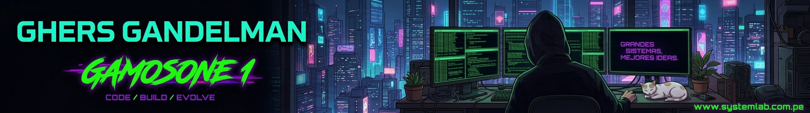
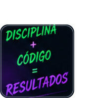
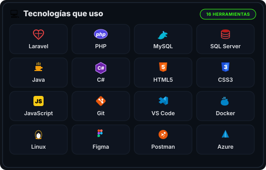
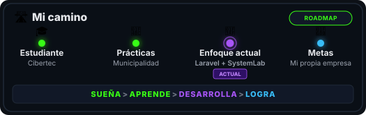
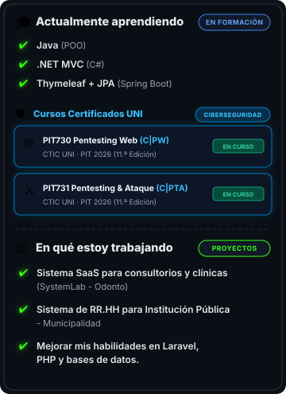
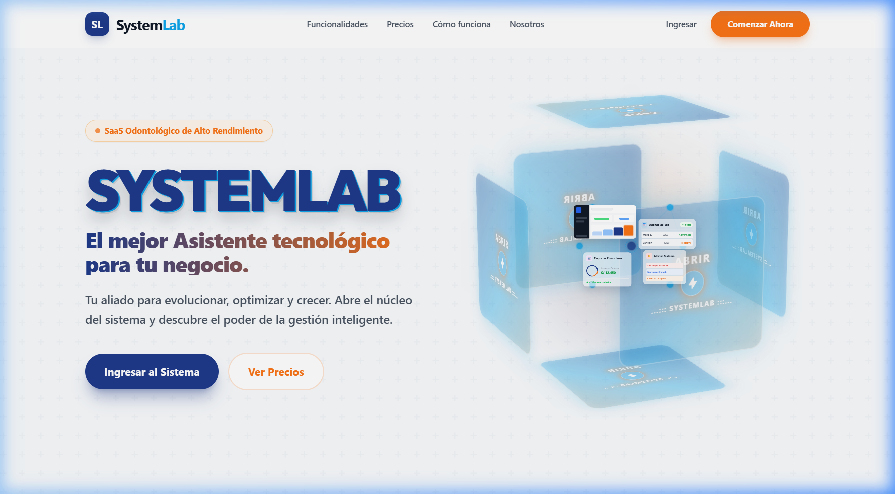
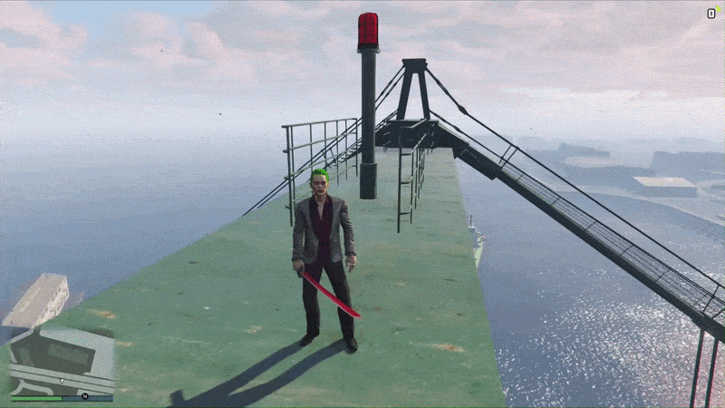

  

 

<table align="center" border="0" cellpadding="0" cellspacing="0" width="100%">
<tr></tr>
<tr bgcolor="#161b22">

<!-- COLUMNA IZQUIERDA -->
<td width="55%" valign="top" bgcolor="#161b22">

<h3><strong><u>👋 Hola, soy Ghers</u></strong></h3>

Bienvenido a mi perfil de GitHub. 
Soy un desarrollador apasionado por la tecnología, enfocado en crear soluciones reales, aprender continuamente y llevar mis ideas al siguiente nivel.

 
 

  

</td>

<!-- COLUMNA DERECHA -->
<td width="45%" valign="top" align="center" bgcolor="#161b22">

</td>
</tr>
</table>

<h2 align="center">🚀 PROYECTOS DESTACADOS</h2>

<table width="100%">
<tr></tr>
<tr bgcolor="#161b22">
<!-- PROYECTO 1: SYSTEMLAB SAAS -->
<td align="center" width="50%" valign="top" bgcolor="#161b22">
<h3>🦷 SystemLab · SaaS en Producción</h3>

  

  

Plataforma SaaS integral orientada a la digitalización y gestión clínica de consultorios odontológicos. Incluye control de pacientes, agenda de citas interactiva por consultorio, odontograma, catálogo y evolución de tratamientos y módulo de cobros con estricta segregación de datos entre clínicas.

 
<b>Stack:</b> PHP · Laravel · MySQL · Blade · TailwindCSS · REST API · Docker
 
Software como Servicio comercial · Arquitectura Single DB Multi-Tenant
  

<b>Detalles técnicos y arquitectura</b>

• <b>Aislamiento Multi-Tenant (Single DB):</b> Implementación de traits y <code>Global Scopes</code> (<code>BelongsToTenant</code>) para segregación y seguridad automática por organización. 
• <b>Gestión Clínica y Citas:</b> Agendamiento sincronizado por consultorio, odontólogo tratante y estado de atención en tiempo real. 
• <b>Historial Clínico y Evolución:</b> Registro estructurado de tratamientos realizados y pagos con alta integridad relacional. 
• <b>Base de Datos & Performance:</b> Modelado relacional optimizado con índices en MySQL, seeders y migraciones escalables.

</td>

<!-- PROYECTO 2: FIVEM LUA SERVER -->
<td align="center" width="50%" valign="top" bgcolor="#161b22">
<h3>🎮 PeruSalen Roleplay · Servidor FiveM & Scripts Lua</h3>

  

  

Desarrollo integral de servidor GTA V Roleplay (PeruSalen) y creación de scripts avanzados programados en <b>Lua</b>. Incluye sistema propio de inventario interactivo con interfaz NUI reactiva, armas/ítems custom (katanas, alas funcionales de vuelo), mecánicas de rol y optimización extrema de recursos.

 
<b>Stack:</b> Lua · FiveM FXServer · NUI (HTML5 / CSS3 / JavaScript) · MySQL / oxmysql · Git
 
Servidor activo · Scripts propios optimizados para bajo consumo de CPU (resmon)
  

<b>Detalles técnicos y optimización</b>

• <b>Arquitectura Cliente/Servidor en Lua:</b> Manejo de eventos de red protegidos, callbacks asíncronos y validación estricta anti-exploit. 
• <b>Interfaz NUI Reactiva:</b> HUD e inventario moderno diseñados con frontend web e integrados mediante callbacks bidireccionales. 
• <b>Optimización de Rendimiento:</b> Tick time constante <code>resmon &lt; 0.02ms</code> asegurando máxima fluidez y cero lag. 
• <b>Mecánicas y Assets Custom:</b> Integración de cosméticos y armas 3D con animaciones sincronizadas y físicas de vuelo.

</td>
</tr>
</table>

 

 

<!-- ══════════════════════════════════════════════════════════════ -->
<!-- SECCIÓN: CONTACTO & ENLACES                                    -->
<!-- ══════════════════════════════════════════════════════════════ -->

  
  
  

